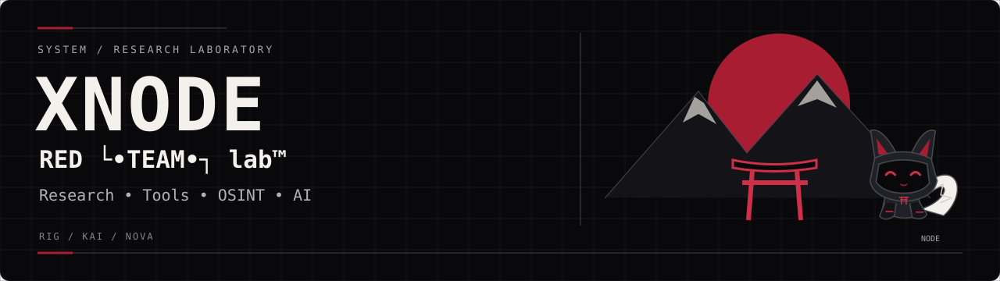

<p align="center"></p>

[Штаб лаборатории](https://github.com/Xnode-sh/RED-TEAM-LAB) · [Профиль XNODE](https://github.com/Xnode-sh)

# vibe-chat

<p align="center">  </p>

TUI-чат с двумя AI-агентами одновременно: **Claude Code** и **opencode**.  
Один интерфейс, один промпт — оба отвечают по очереди или по отдельности.

## Установка

```bash
python -m venv .venv
.venv\Scripts\pip install textual   # Windows
# или: .venv/bin/pip install textual
```

Также нужны глобально:
```bash
npm install -g @anthropic-ai/claude-code opencode-ai
```

## Запуск

```bash
python chat_tui.py
```

## Управление

| Hotkey   | Действие                    |
|----------|-----------------------------|
| Ctrl+C   | Только Claude Code          |
| Ctrl+O   | Только opencode             |
| Ctrl+B   | Оба агента (по умолчанию)   |
| Ctrl+L   | Очистить историю            |
| Enter    | Отправить                   |

## Структура

```
chat_tui.py    TUI (Textual) — главный файл
server.mjs     Node.js dev-сервер (опционально)
public/        статика для server.mjs
.opencode/     конфиг opencode
```

## Настройка модели opencode

```bash
set VIBE_OC_MODEL=openrouter/poolside/laguna-s-2.1:free
python chat_tui.py
```

## Требования

- Python 3.11+
- `textual`
- Node.js (для server.mjs)
- Claude Code CLI (`claude.exe` глобально)
- opencode CLI (`opencode.exe` глобально)


## Инженерный процесс лаборатории

`PLAN → ISSUE → BRANCH → WORK → TEST → PR → REVIEW → MERGE`

Команда: **FREYA / LIRA / KRIPTO**. NODE — фирменный маскот. [Правила работы](https://github.com/Xnode-sh/RED-TEAM-LAB/blob/main/WORKFLOW.md).
